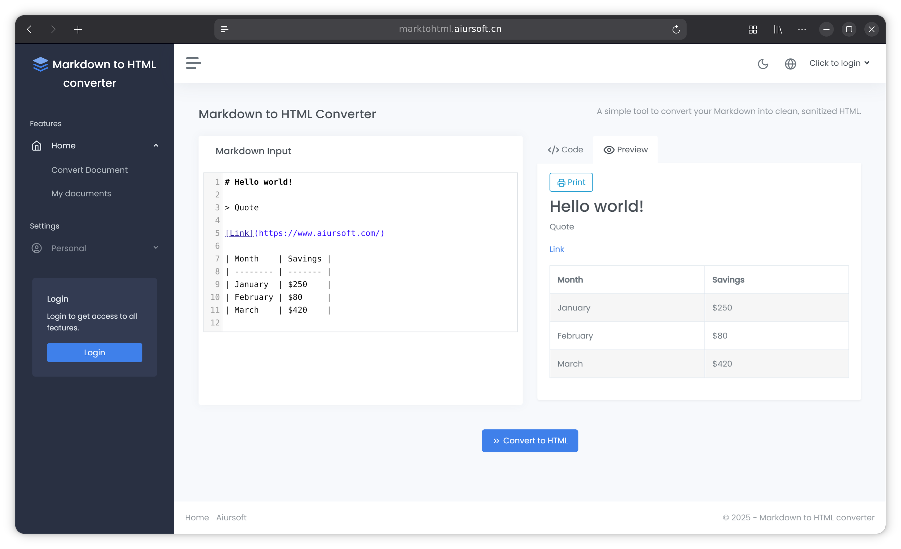

# MarkToHtml

[](https://github.com/aiursoftweb/markToHtml/blob/master/LICENSE)
[](https://gitlab.aiursoft.com/aiursoft/markToHtml/-/pipelines)
[](https://gitlab.aiursoft.com/aiursoft/markToHtml/-/pipelines)
[](https://s360.aiursoft.com/SupplyChain?tab=projects&project=aiursoft%2Fmarktohtml&scope=baseline&ecosystem=all)
[](https://manhours.aiursoft.com/r/github.com/aiursoftweb/markToHtml.html)
[](https://marktohtml.aiursoft.com)
[](https://hub.docker.com/r/aiursoft/marktohtml)

A simple tool to convert your Markdown into clean, sanitized HTML.



Default user name is `admin@default.com` and default password is `Admin@123456!`.

## Try

Try a running MarkToHtml [here](https://marktohtml.aiursoft.com).

## Why MarkToHtml for Your Organization

MarkToHtml is a production-ready, enterprise-grade knowledge base platform designed for teams that value simplicity without sacrificing essential features. While commercial solutions like Notion charge $10+ per user monthly and lack self-hosting options, MarkToHtml delivers a comprehensive document collaboration system that deploys in minutes and costs nothing to run on your own infrastructure.

Key enterprise features include:

**Flexible Data Infrastructure.** Seamlessly switch between SQLite for quick deployment, MySQL for scalability, SQL Server for enterprise environments, or in-memory databases for testing. No complex configuration required.

**Enterprise Authentication.** Native OpenID Connect integration allows seamless connection to your existing identity provider with automatic role synchronization. Built-in user management provides a complete authentication solution out of the box.

**Fine-Grained Access Control.** Role-Based Access Control system with comprehensive permissions for users, roles, and documents. Dynamic navigation automatically adapts to user permissions, ensuring users only see what they should.

**Global-Ready Platform.** AI-powered translation supporting 27 languages enables worldwide team collaboration without language barriers. Comprehensive localization coverage ensures consistent user experience across cultures.

## Install with Docker

Run the installer with the desired port (omit it to choose an available port):

```bash
curl -fsSL https://raw.githubusercontent.com/aiursoftweb/marktohtml/master/install.sh | sudo bash -s -- 8080
```

Installation starts after three seconds; press Ctrl+C to cancel. Then open `http://localhost:8080`.

## Run manually

Requirements about how to run

1. Install [.NET 10 SDK](http://dot.net/) and [Node.js](https://nodejs.org/).
2. Execute `npm install` at `wwwroot` folder to install the dependencies.
3. Execute `dotnet run` to run the app.
4. Use your browser to view [http://localhost:5000](http://localhost:5000).

## Run in Microsoft Visual Studio

1. Open the `.sln` file in the project path.
2. Press `F5` to run the app.

## Run in Docker

First, install Docker [here](https://docs.docker.com/get-docker/).

Then run the following commands in a Linux shell:

```bash
image=aiursoft/marktohtml
appName=marktohtml
sudo docker pull $image
sudo docker run -d --name $appName --restart unless-stopped -p 5000:5000 -v /var/www/$appName:/data $image
```

That will start a web server at `http://localhost:5000` and you can test the app.

The docker image has the following context:

| Properties  | Value                           |
|-------------|---------------------------------|
| Image       | aiursoft/marktohtml         |
| Ports       | 5000                            |
| Binary path | /app                            |
| Data path   | /data                           |
| Config path | /data/appsettings.json          |

## Agent runtime and offline evaluation

The document-editing agent uses AgentKit's `OrderedAgentRunner`. `AgentService` owns
conversations and queue admission; `AgentSessionFacade` owns canonical execution,
approval decisions, continuation budgets and UI/Advice projection.

### Approval and recovery behavior

- Read tools run without write approval. Proposed writes do not persist until explicitly approved.
- Approving a write executes that operation; the model resumes only after every call in the
  current batch has a result. Rejecting the final pending write can also resume the model.
- Each user turn has a ten-model-attempt budget. A continuation retains canonical history and
  reasoning, appends the latest document context, and starts a fresh budget.
- Missing or blank tool call IDs are protocol failures. Model failures use a safe generic message
  rather than exposing raw provider exception text.
- Write exceptions remain failed executions and provide safe recovery guidance. A failure can
  occur after updating in-memory content, so it does not prove that nothing changed. Do not
  blindly retry; reading the current in-memory document is not proof of persisted content.
- A tool returning ordinary business-error text is still a returned dispatch, not necessarily
  a successful edit. Evaluate document state separately from the runner outcome.

Cancellation currently removes the conversation and its Advice; it does **not** cancel work
already in flight. Such work can finish and create orphan Advice. This is a known limitation,
not a guarantee of rollback or a safe signal to retry a write.

### Run the offline exam

From the repository root, with the .NET 10 SDK installed:

```bash
dotnet run --project src/Aiursoft.MarkToHtml.ExamRunner
```

The runner executes five deterministic scenarios: read-only, approved write, rejected write,
failed persistence, and continuation. It uses a scripted model, real tool bindings and isolated
EF Core InMemory data. It does not start the web application, load application credentials or
call a model endpoint. Package restore may require network access on the first run.

Human-readable PASS/FAIL summaries go to stderr; evaluator results are JSON on stdout. To save
only the JSON yourself:

```bash
dotnet run --project src/Aiursoft.MarkToHtml.ExamRunner --no-build --no-restore > exam-results.json
```

The second command requires an existing build. Exit codes are `0` for all cases passing,
`1` for an evaluation/execution failure, and `2` for unsupported arguments. There are currently
no CLI options or live-model mode. A PASS for the failed-write scenario means the expected
failure and recovery boundaries were handled correctly, not that the write succeeded.

`Aiursoft.MarkToHtml.AgentExam` references the application and AgentKit Evaluator;
`Aiursoft.MarkToHtml.ExamRunner` references AgentExam. The web application does not reference
Evaluator or either exam project.

Evidence covers only the current turn, excludes imported legacy-history placeholders, and
counts actual dispatches rather than unresolved proposals or rejected writes. Model iteration
counts include failed attempts. Canonical runner results are preserved; supplemental observed
traces retain absolute batch/call identity when the runner coalesces reused IDs. Missing or
inconsistent trace correlation invalidates evidence rather than inventing records or timings.

Runtime document snapshots are explicitly in-memory and do not verify persistence. The exam
separately checks seeded database content through a fresh context. These checks are execution
contracts, not a real-model quality benchmark, HTTP authorization test, or proof of relational
transaction durability. Tool durations vary; step-level elapsed timing is unavailable.

Run only the relevant tests when changing the exam or session boundary:

```bash
dotnet test tests/Aiursoft.MarkToHtml.Tests.csproj --filter 'FullyQualifiedName~AgentExamTests|FullyQualifiedName~AgentSessionFacadeTests'
```

## How to contribute

There are many ways to contribute to the project: logging bugs, submitting pull requests, reporting issues, and creating suggestions.

Even if you with push rights on the repository, you should create a personal fork and create feature branches there when you need them. This keeps the main repository clean and your workflow cruft out of sight.

We're also interested in your feedback on the future of this project. You can submit a suggestion or feature request through the issue tracker. To make this process more effective, we're asking that these include more information to help define them more clearly.
